## Status update — 9 November 2026

The frozen Spectral BCI Decoder has now completed the official **Track 02 Sealed Final Phase** evaluation: submission **1044841**, status **Finished**, displayed cell-averaged balanced accuracy **0.458**. The platform shows one submission used out of five for this phase. The authenticated receipt and captures are retained privately.

The [exact scored reference ZIP](releases/20261109/Agnuxo_SpectralBCI_Track02_sealed_reference_20261109.zip) is 25,060 bytes, SHA-256 08c3effa375b93401f60beb65feb8f3a8d739db0652c7785fc616a969a7b3a45. Its inference source and trained weights are byte-for-byte identical to the earlier warm-up package; only the [method and data/compute declaration](releases/20261109/METHOD.md), MIT licence and citation metadata were added. Three new checks used the actual current Solver and Objective classes on CPU with synthetic fixtures; a separate positive control distinguished cell, session and pooled scoring. Recovery required no retraining or new access to study EEG or feature caches.

The historical **0.38 warm-up** result below remains a separate observation on a different evaluation cohort. The two phase scores do not measure a performance improvement. Final ranking, reproducibility audit, selection and prizes are unverified. The earlier text and all figures below are preserved in full as the development record.

The executable input is four seconds (41 channels,480 samples at120Hz); spectral features use one Hann-tapered FFT for each window.

---

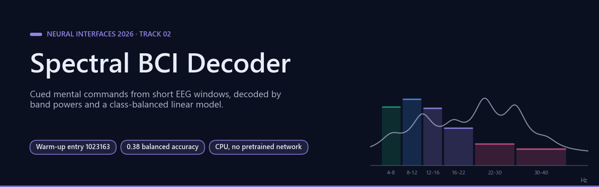

# Neural Interfaces 2026 — Track 02 | Spectral BCI Decoder

      

[**Official result**](#official-result-and-scientific-evidence) · [**Method**](#method) · [**Independent checks**](#independent-checks) · [**Reproduce**](#reproduce) · [**Observations**](#observations-and-limitations) · [**Bibliography**](#bibliography)

**A fully trained, independently audited EEG decoding model with a completed official Codabench warm-up evaluation.**

[Official competition / Track 02](https://www.codabench.org/competitions/17982/) · [Download the exact accepted ZIP](Agnuxo_SpectralBCI_Track02.zip) · [Original public data (NEMAR nm000290)](https://nemar.org/dataexplorer/detail?dataset_id=nm000290)

Neural Interfaces 2026 Track 02 challenges participants to decode cued mental commands from short EEG windows. This open-source research entry provides an entirely CPU-compatible, causal, interpretable spectral model trained on the official public PROTEUS dataset. No cloud API, participant-ID lookup, hidden competition label or pretrained network is used.

**Contents** — [Official result and scientific evidence](#official-result-and-scientific-evidence) · [Method](#method) · [Background](#background) · [Independent checks](#independent-checks) · [Files](#files) · [Reproduce](#reproduce) · [Expected applications](#expected-applications) · [Observations and limitations](#observations-and-limitations) · [Possible improvements](#possible-improvements) · [Future work](#future-work) · [Bibliography](#bibliography)

## Official result and scientific evidence

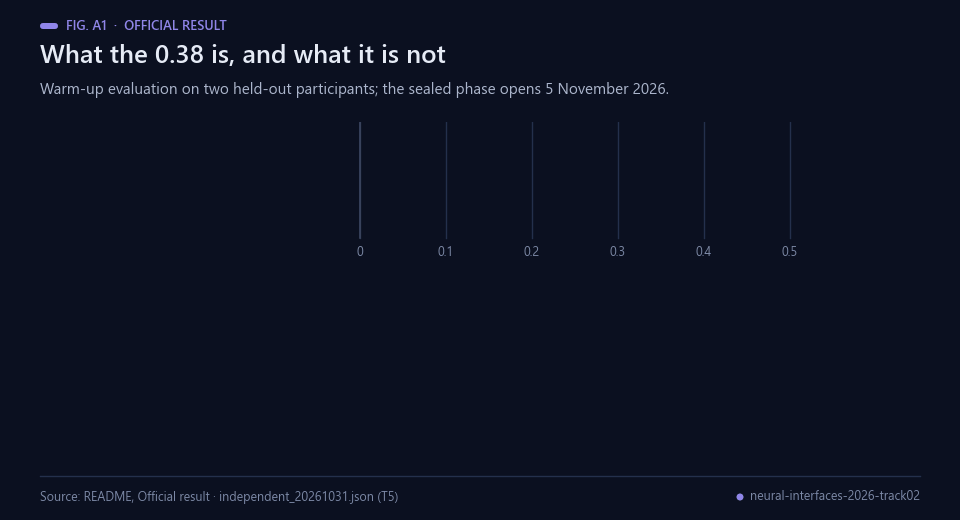 Animated figure A1 — The warm-up score with its interval and its reference floor. Data: the table below and independent_20261031.json.

| Item | Verified result |
|---|---|
| Codabench warm-up entry | **1023163** |
| Official evaluation state | **Finished** on 31 October 2026 at 09:14 CET |
| Official rounded score | **0.38 balanced accuracy** |
| Independent cross-subject holdout score | **0.37535842293906807** |
| Training / validation / test | 1,521 / 379 / 755 EEG windows |
| Train / validation / test participants | **6 / 2 / 2, mutually disjoint** |
| Validated official context cells | 8 held-out subject × recording × interface cells |
| Five independent quality-control experiments | **5/5 passed** |
| Exact ZIP SHA-256 | **d5a1f2bef886fcd775b5a41338612f016087f0c6a4b321dc3ef33e27987de0cd** |

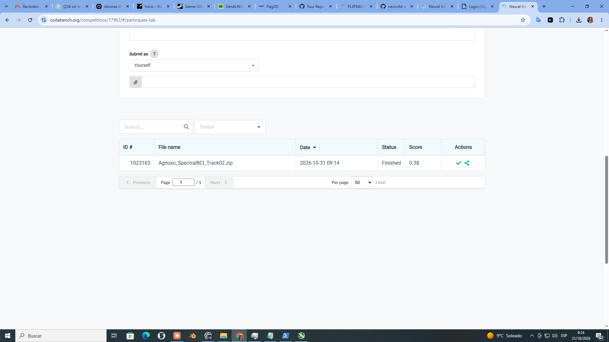

The official score reproduces the independently calculated held-out score after rounding. The reference floor for three equally likely classes is approximately 0.333, but that theoretical value is not a substitute for a same-data head-to-head baseline. **This is a warm-up submission, not a sealed-phase competition entry or a prize result.** The sealed phase opens 5 November and closes 21 November 2026.

## Method

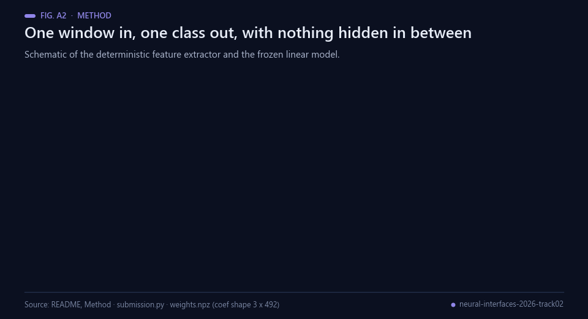 Animated figure A2 — Schematic of the pipeline; the shapes are read from submission.py and weights.npz.

Each input is one `(B, 41, 480)` EEG window sampled at 120 Hz. The deterministic feature extractor subtracts each observed channel's temporal mean, then calculates a Hann-tapered Fourier transform with six bandpowers: 4–8, 8–12, 12–16, 16–22, 22–30 and 30–40 Hz. Absolute log-power and across-channel relative log-power yield 492 interpretable features. A class-balanced multinomial logistic regression is trained on these features, with scaling statistics frozen from the public training partition.

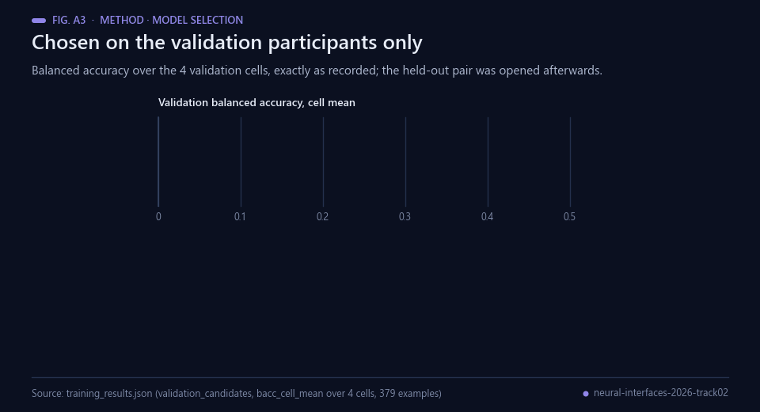 Animated figure A3 — Selection on the validation participants only. Data: training_results.json.

Model selection tested C = 0.005, 0.05, 0.5 and 5.0 on the validation participants only; C = **0.005** was selected. The final frozen model was refitted on train plus validation subjects, and the two held-out participants were evaluated only after selecting the model. Predicted labels are 0, 1 and 2, in the official order. There are no recurrent cross-session states, and no participant metadata is used during inference.

## Background

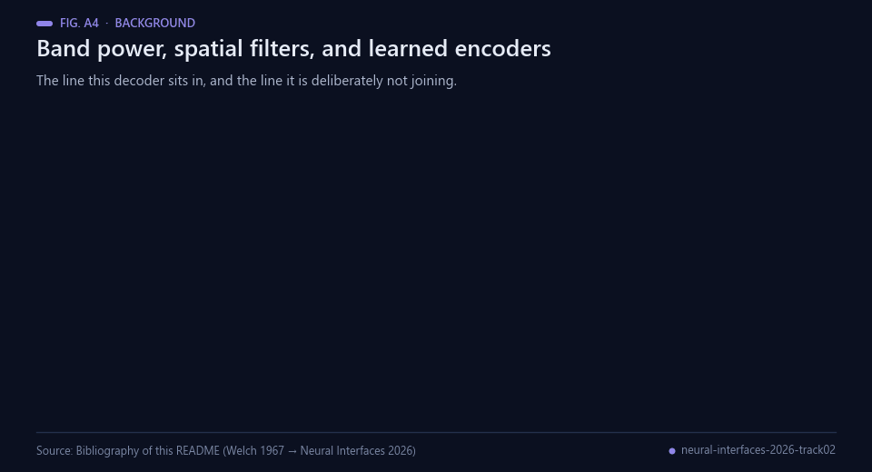 Animated figure A4 — Milestones behind this decoder. Sources: bibliography below.

Everything this decoder computes has been in use for decades. Welch's method estimates a power spectrum by
averaging over windowed segments [[5](#ref-5)], which is what the Hann-tapered transform in `submission.py`
does per 5 s window; Pfurtscheller and Lopes da Silva set out the principle the band powers rest on, that
band power rises and falls with the task in event-related synchronisation and desynchronisation
[[4](#ref-4)]; and Hjorth-style time-domain descriptors and band ratios have been standard features since.
The BCI field then built spatial filters on top: common spatial patterns optimised for robust single-trial
analysis [[6](#ref-6)], filter-bank variants that select the frequency range as well [[7](#ref-7)], and
Riemannian-geometry classifiers that treat the covariance matrix itself as the feature [[8](#ref-8)].

The decade since has moved towards learned encoders — EEGNet, a compact convolutional network designed so
one architecture serves several BCI paradigms [[9](#ref-9)], and more recently pretrained EEG foundation models
such as REVE [[10](#ref-10)]. Public datasets made that possible: Dreyer and colleagues released a large EEG
database with user profile information for motor-imagery BCI research [[3](#ref-3)], and the PROTEUS recordings
used here are distributed through NEMAR [[2](#ref-2)] with the organisers' own starter kit defining the split
and the preprocessing [[17](#ref-17)].

This entry deliberately sits on the older side of that line, and the reason is evaluation rather than
nostalgia. Cross-subject BCI performance varies enough between people that transfer between subjects is a
research field of its own [[13](#ref-13)], and a substantial share of users score near chance with a given
paradigm [[14](#ref-14)]. Balanced accuracy is the metric used precisely because it does not reward predicting
the majority class [[11](#ref-11)], and the interval around it here comes from a cluster bootstrap over the
eight held-out cells [[12](#ref-12)]. With a sample that small, methodological failures of the familiar
kinds — a too-small test set, a baseline that was never run, information crossing the split
[[15](#ref-15), [16](#ref-16)] — would be easier to commit than to detect, which is why the checks in this repository
are about the package and the protocol rather than about the score.

## Independent checks

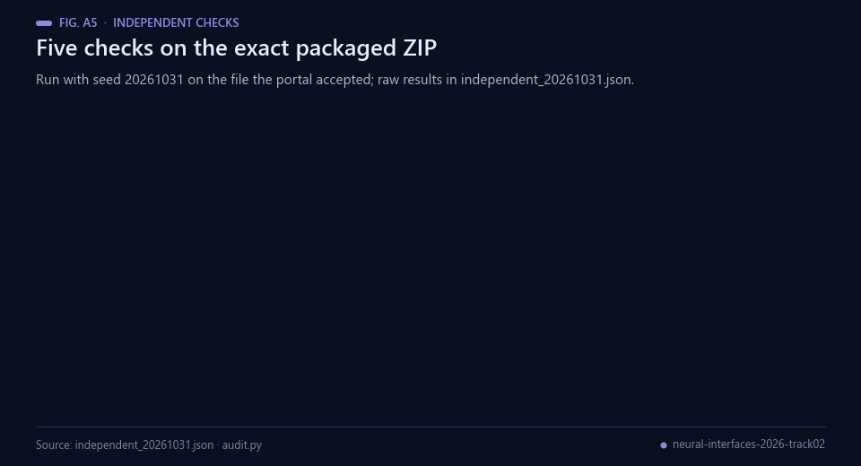 Animated figure A5 — The five checks on the exact packaged ZIP. Data: independent_20261031.json.

All five external checks executed on the *exact packaged ZIP*, with seed **20261031**. Their machine-readable raw results are in [independent_20261031.json](independent_20261031.json).

1. ZIP structure, 492-feature dimensions, valid classes and finite coefficients: **PASS**.
2. Identical predictions for batch mode and one-window streaming across 30 windows: **PASS**, zero disagreements.
3. Perturbing future windows cannot change the first 11 decisions: **PASS**, zero leakage violations.
4. All-zero, NaN, infinity and grossly outlying input windows return valid finite class IDs: **PASS**.
5. Eight-cell holdout accuracy independently recalculated to **0.3753584229**. A 2,000-resample cell bootstrap gave **95% CI [0.34896, 0.40868]**: **PASS**.

## Files

| File | Purpose |
|---|---|
| [submission.py](submission.py) | Self-contained frozen inference implementation conforming to `CompetSolver` |
| [weights.npz](weights.npz) | Trained real-data multinomial coefficients and scaling |
| [Agnuxo_SpectralBCI_Track02.zip](Agnuxo_SpectralBCI_Track02.zip) | Exact file accepted and scored by the official Codabench portal |
| [train_public.py](train_public.py) | Deterministic train / validation / held-out evaluation and ZIP packaging |
| [audit.py](audit.py) | Independent tests on the exact packaged entry |
| [training_results.json](training_results.json) | Original raw split assignments, model comparison and measured results |
| [independent_20261031.json](independent_20261031.json) | Audited results and uncertainty estimates |
| [kit_compat.py](kit_compat.py) | Explicit documented Windows/NeuralBench 0.4.0 compatibility layer |
| [docs/](docs/) | Official scored warm-up screenshot |

## Reproduce

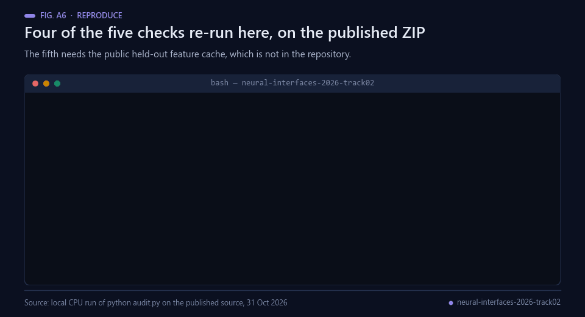 Animated figure A6 — A real CPU re-run on the published ZIP, 31 Oct 2026; its output matched audit_replay_latest.json.

Use Python 3.11 or later, the public [organiser's starter kit](https://github.com/neural-interfaces26/2026-competition) pinned to commit **2b53aec91c111f8b5423b6674f096c48cc1a99af**, and the legitimately downloaded public [PROTEUS NEMAR nm000290](https://nemar.org/dataexplorer/detail?dataset_id=nm000290). Reproduction uses the *organiser's* train/validation/test split and preprocessing; no raw EEG data is redistributed in this repository.

First clone this repository and the organisers' starter kit, then install the dependencies using `python -m pip install -r requirements.txt` in a virtual environment. Download the public PROTEUS dataset through NeuralBench or the starter kit; set `BCI_KIT_DIR` to the top-level starter-kit directory and `BCI_DATA_DIR` to the directory holding `Dreyer2026Proteus`. Run `python train_public.py` to refit the model. `python audit.py` runs the independent package checks using the logged public test features; for auditing the original result, the checked-in JSON is the preserved raw output. The official ZIP can be uploaded directly without retraining.

The original development workstation used the public data directory `E:\Proyecto-concursos\NeuralTrack02\public_data`, a 6-CPU-thread local run, and did not use Server-IA or paid Codex API. All training code and the full verification history are preserved. To run a new offline test on a fresh machine, first prepare the organisers' study and then execute the training pipeline; the downloaded raw data must remain outside Git.

## Expected applications

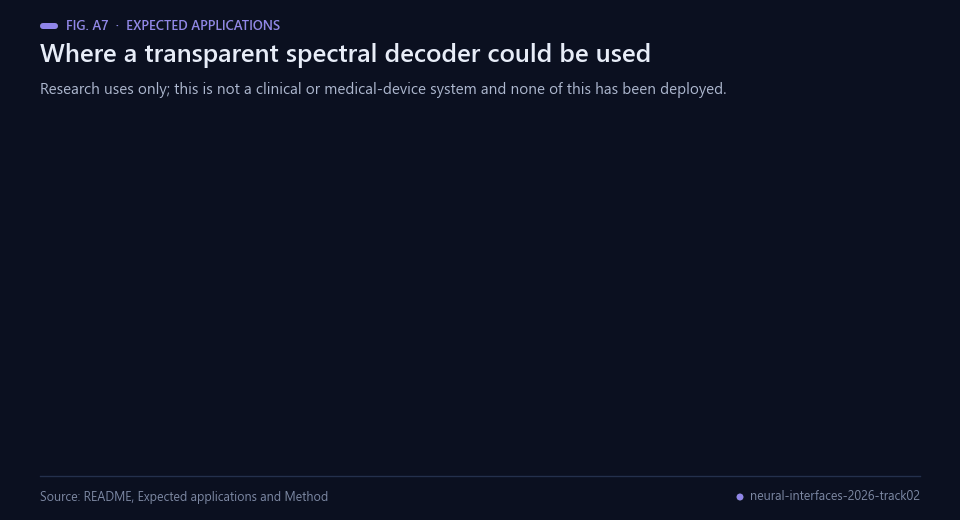 Animated figure A7 — Research uses only; not a clinical or medical-device system.

This compact approach is suitable for research on subject-independent BCI decoding, transparent comparisons between neurophysiological band features and learned neural encoders, and low-compute experimentation. It is not a clinical or medical-device system.

## Observations and limitations

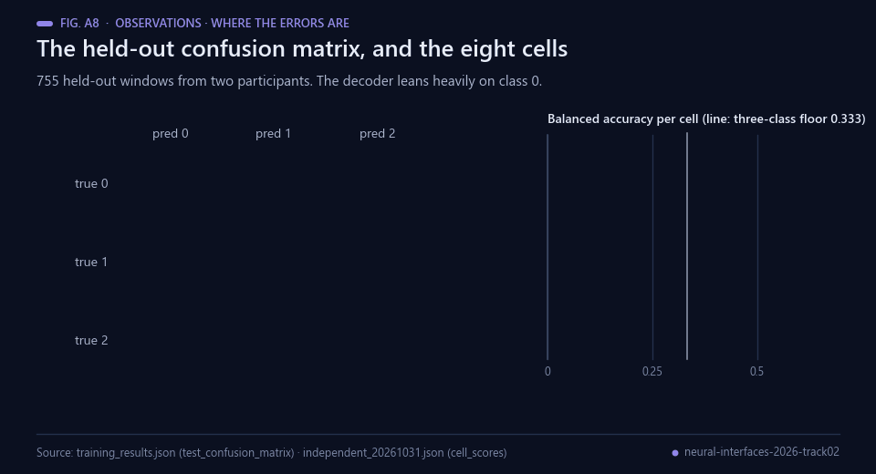 Animated figure A8 — Where the errors are. Data: training_results.json and independent_20261031.json.

The public evaluation consists of only two held-out participants (eight official subject/session/context cells), so the interval reflects a limited sample. Subject shift remains substantial. The 0.38 result is specific to this public warm-up task and cannot be extrapolated to the hidden sealed phase or a leaderboard win. No unreleased data or paid pretrained network was used.

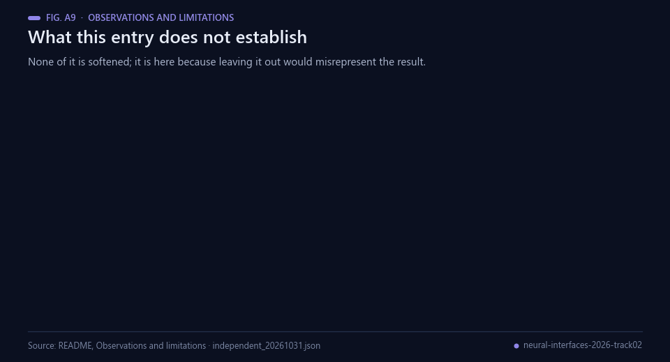 Animated figure A9 — What is not claimed. Data: this section and independent_20261031.json.

**Author:** Francisco Angulo de Lafuente · [Agnuxo1](https://github.com/Agnuxo1) · Spain. New source code: MIT License. NEMAR data and the organisers' kit retain their own terms.

## Possible improvements

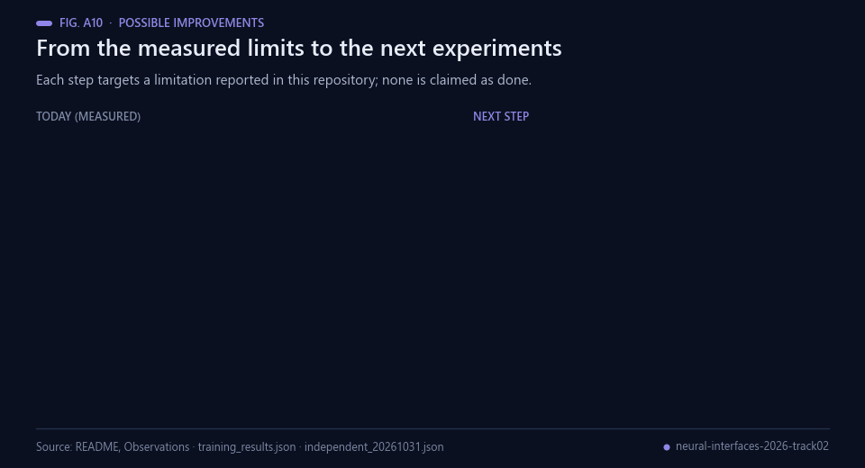 Animated figure A10 — Each improvement targets a limitation reported in this repository.

- **Run a same-data baseline.** The three-class reference floor is a theoretical value and the README says
  it is not a substitute for a head-to-head comparison. A common-spatial-pattern pipeline [[6](#ref-6), [7](#ref-7)],
  a Riemannian classifier [[8](#ref-8)] and EEGNet [[9](#ref-9)] on exactly these splits would turn 0.38 into a
  number with a comparison beside it.
- **Report per-class recall next to the balanced accuracy.** The held-out confusion matrix shows most
  windows predicted as class 0 even though training was class-balanced; balanced accuracy alone hides which
  class is being lost [[11](#ref-11)].
- **Leave one participant out over all ten.** Two held-out participants and eight cells give a 95 %
  interval of [0.34896, 0.40868]. A leave-one-participant-out protocol would give every participant a
  held-out estimate and a tighter picture of the subject shift [[13](#ref-13), [14](#ref-14)].
- **Nest the model selection.** C was chosen on four validation cells from two participants; nesting the
  choice inside the participant folds removes one more place where a single pair decides the outcome
  [[15](#ref-15)].
- **Keep the package checks, and add a leakage check across sessions.** The existing checks already cover
  streaming equivalence and future-window contamination; the remaining risk at this sample size is
  information shared between a participant's sessions [[16](#ref-16)].

## Future work

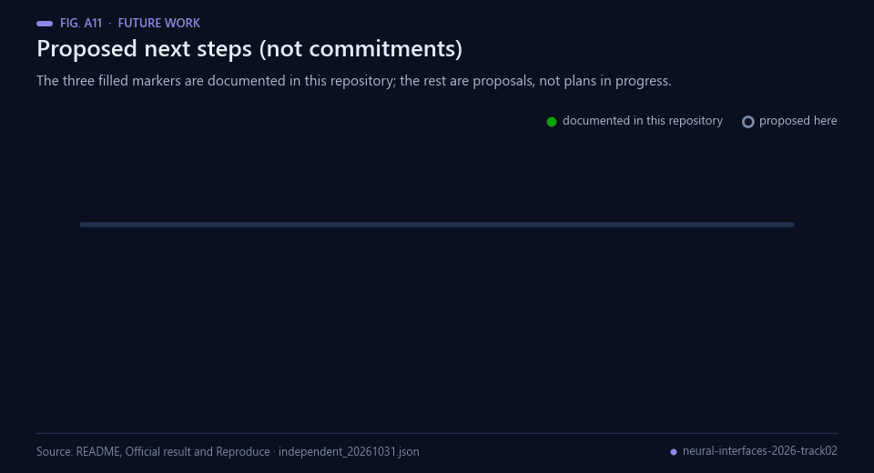 Animated figure A11 — The three filled markers are documented in this repository; the rest are proposals.

Proposed next steps, not commitments. Only the first three are documented in this repository as done; the
others are proposals and none is claimed as started:

1. *Documented.* The model was trained and frozen, with C selected on the validation participants only and
   the held-out pair opened afterwards (`training_results.json`).
2. *Documented.* Five checks were run on the exact packaged ZIP, all passing
   (`independent_20261031.json`).
3. *Documented.* The warm-up evaluation on Codabench finished on 31 October 2026 with a rounded score of
   0.38 [[1](#ref-1)].
4. Run a same-data baseline on these splits, so the score has a comparison beside it.
5. Repeat the evaluation leave-one-participant-out across all ten participants.
6. Enter the sealed phase, which opens on 5 November and closes on 21 November 2026 [[1](#ref-1)]. No result
   on it is claimed or predicted here.

## Bibliography

1. Neural Interfaces 2026 organizers (2026). *Track 02* (Codabench competition 17982). https://www.codabench.org/competitions/17982/
2. Dreyer Pauline, Bourdil Manon, Bechon Loic, et al. (2026). *PROTEUS BCI Bordeaux — EEG/EMG Foundation Challenge 2026, Track 02*. NEMAR (Neuroelectromagnetic Data Archive and Tools Resource). https://doi.org/10.82901/nemar.nm000290
3. Dreyer, P., Roc, A., Pillette, L., Rimbert, S., & Lotte, F. (2023). A large EEG database with users’ profile information for motor imagery brain-computer interface research. *Scientific Data*, 10(1). https://doi.org/10.1038/s41597-023-02445-z
4. Pfurtscheller, G., & Lopes da Silva, F.H. (1999). Event-related EEG/MEG synchronization and desynchronization: basic principles. *Clinical Neurophysiology*, 110(11), 1842–1857. https://doi.org/10.1016/S1388-2457(99)00141-8
5. Welch, P. (1967). The use of fast Fourier transform for the estimation of power spectra: A method based on time averaging over short, modified periodograms. *IEEE Transactions on Audio and Electroacoustics*, 15(2), 70–73. https://doi.org/10.1109/TAU.1967.1161901
6. Blankertz, B., Tomioka, R., Lemm, S., Kawanabe, M., & Muller, K. (2008). Optimizing Spatial filters for Robust EEG Single-Trial Analysis. *IEEE Signal Processing Magazine*, 25(1), 41–56. https://doi.org/10.1109/MSP.2008.4408441
7. Kai Keng Ang, Zhang Yang Chin, Haihong Zhang, & Cuntai Guan (2008). Filter Bank Common Spatial Pattern (FBCSP) in Brain-Computer Interface. *2008 IEEE International Joint Conference on Neural Networks (IEEE World Congress on Computational Intelligence)*, 2390–2397. https://doi.org/10.1109/IJCNN.2008.4634130
8. Barachant, A., Bonnet, S., Congedo, M., & Jutten, C. (2012). Multiclass Brain–Computer Interface Classification by Riemannian Geometry. *IEEE Transactions on Biomedical Engineering*, 59(4), 920–928. https://doi.org/10.1109/TBME.2011.2172210
9. Lawhern, V. J., Solon, A. J., Waytowich, N. R., et al. (2018). EEGNet: a compact convolutional neural network for EEG-based brain–computer interfaces. *Journal of Neural Engineering*, 15(5), 056013. https://doi.org/10.1088/1741-2552/aace8c
10. El Ouahidi, Y., Lys, J., Thölke, P., et al. (2025). REVE: A Foundation Model for EEG - Adapting to Any Setup with Large-Scale Pretraining on 25,000 Subjects. *Advances in Neural Information Processing Systems 38*, 25583–25619. https://doi.org/10.52202/085713-0760
11. Brodersen, K. H., Ong, C. S., Stephan, K. E., & Buhmann, J. M. (2010). The Balanced Accuracy and Its Posterior Distribution. *2010 20th International Conference on Pattern Recognition*, 3121–3124. https://doi.org/10.1109/ICPR.2010.764
12. Efron, B. (1979). Bootstrap Methods: Another Look at the Jackknife. *The Annals of Statistics*, 7(1), 1–26. https://doi.org/10.1214/aos/1176344552
13. Jayaram, V., Alamgir, M., Altun, Y., Scholkopf, B., & Grosse-Wentrup, M. (2016). Transfer learning in brain-computer interfaces. *IEEE Computational Intelligence Magazine*, 11(1), 20–31. https://doi.org/10.1109/MCI.2015.2501545
14. Vidaurre, C., & Blankertz, B. (2009). Towards a Cure for BCI Illiteracy. *Brain Topography*, 23(2), 194–198. https://doi.org/10.1007/s10548-009-0121-6
15. Varoquaux, G., & Cheplygina, V. (2022). Machine learning for medical imaging: methodological failures and recommendations for the future. *npj Digital Medicine*, 5(1). https://doi.org/10.1038/s41746-022-00592-y
16. Kaufman, S., Rosset, S., Perlich, C., & Stitelman, O. (2012). Leakage in data mining. *ACM Transactions on Knowledge Discovery from Data*, 6(4), 1–21. https://doi.org/10.1145/2382577.2382579
17. Neural Interfaces 2026 organizers (2026). *2026-competition starter kit* (source code, commit 2b53aec91c111f8b5423b6674f096c48cc1a99af). https://github.com/neural-interfaces26/2026-competition

---

Built by <a href="https://github.com/Agnuxo1">Francisco Angulo de Lafuente</a> · every figure is an animated
rendering of the published file named in its footer · <a href="#neural-interfaces-2026--track-02--spectral-bci-decoder">back to top ↑</a>

